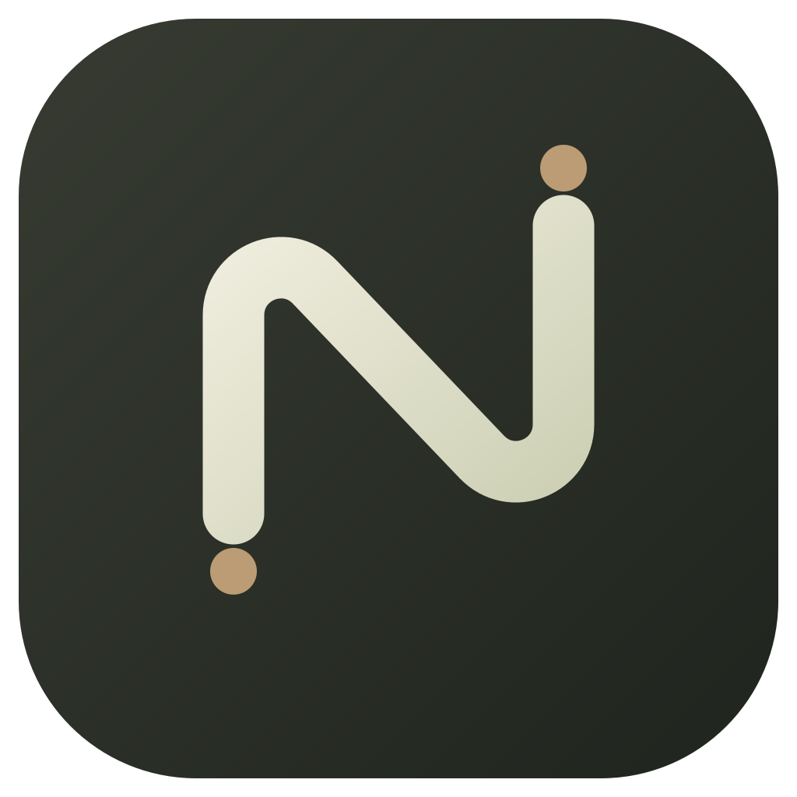
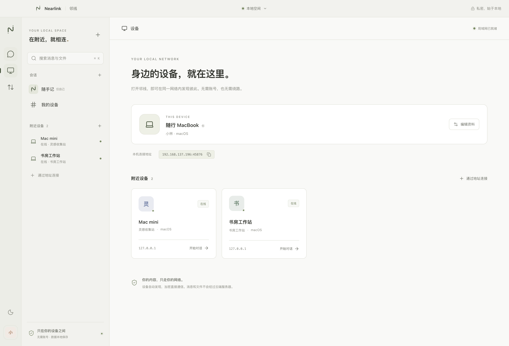
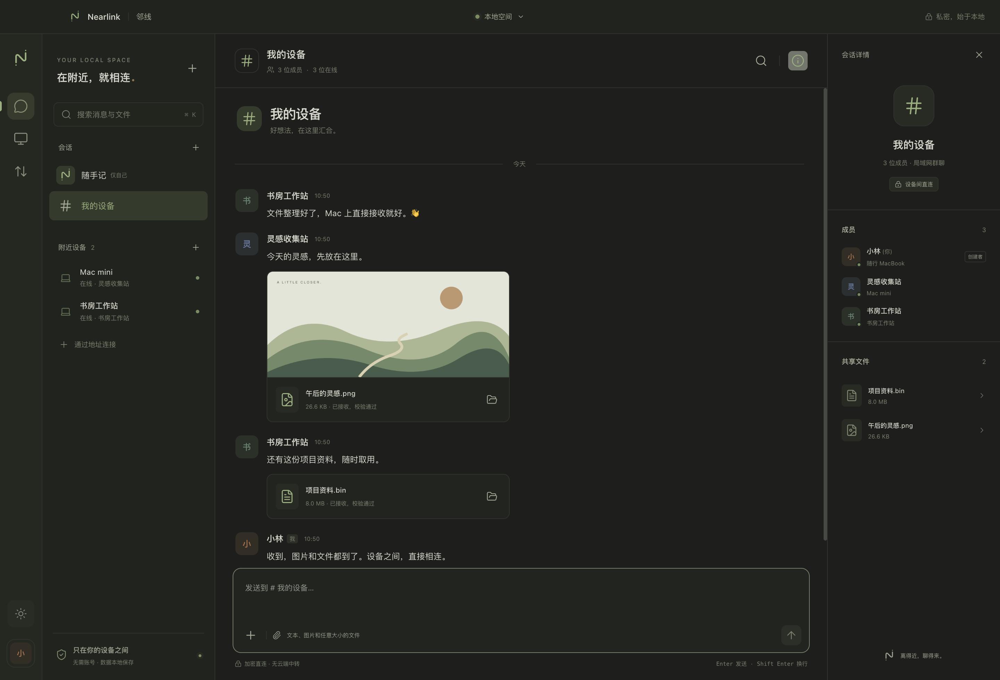

<p align="center"></p>
<h1 align="center">Nearlink · 邻线</h1>
<p align="center">在附近，就相连。<br />A little closer. Entirely local.</p>
<p align="center">无需账号的局域网聊天与文件传输，连接你的 Mac 和 Windows。</p>
<p align="center">
  <a href="https://github.com/lanhas/nearlink/releases/latest"></a>
  <a href="https://github.com/lanhas/nearlink/actions/workflows/ci.yml"></a>
  <a href="LICENSE"></a>
</p>

<p align="center"><a href="https://github.com/lanhas/nearlink/releases/latest/download/Nearlink-mac-arm64.dmg"><strong>下载 macOS · Apple Silicon</strong></a> &nbsp; · &nbsp; <a href="https://github.com/lanhas/nearlink/releases/latest/download/Nearlink-win-x64-setup.exe"><strong>下载 Windows · x64</strong></a></p>


## 下载与安装

| 平台                  | 安装包                                                                                                 | 其他方式                                                                                                |
| --------------------- | ------------------------------------------------------------------------------------------------------ | ------------------------------------------------------------------------------------------------------- |
| macOS 13+，M 系列芯片 | [DMG 安装包](https://github.com/lanhas/nearlink/releases/latest/download/Nearlink-mac-arm64.dmg)       | [ZIP 压缩包](https://github.com/lanhas/nearlink/releases/latest/download/Nearlink-mac-arm64.zip)        |
| Windows 10/11，x64    | [EXE 安装程序](https://github.com/lanhas/nearlink/releases/latest/download/Nearlink-win-x64-setup.exe) | [便携版 EXE](https://github.com/lanhas/nearlink/releases/latest/download/Nearlink-win-x64-portable.exe) |

所有文件与 SHA-256 校验和见 [GitHub Releases](https://github.com/lanhas/nearlink/releases/latest)。

当前版本没有 Apple Developer ID 公证或 Windows 商业代码签名。macOS 首次打开若被拦截，可在「系统设置 → 隐私与安全性」选择「仍要打开」；Windows 可能显示 SmartScreen 提示，确认来源是此仓库后选择「更多信息 → 仍要运行」。无需关闭系统安全保护。安装程序是当前用户安装，便携版仍会将聊天数据保存在用户数据目录。

## 开始使用

1. 在各台设备安装并打开邻线，连接同一个 Wi-Fi 或有线局域网。
2. 首次出现网络访问提示时，允许邻线访问本地/专用网络。
3. 点击左侧「附近设备」开始私聊；点击「＋」选择至少两台其他设备创建群聊。
4. 输入文字直接发送。拖入文件、点击输入框加号添加附件，或粘贴剪贴板图片。
5. 普通文件点击下载按钮接收，可暂停、续传、另存或在文件夹中显示。10 MB 内的 PNG/JPEG/GIF/WebP 图片会自动接收并预览。

没有发现设备时，在「设备」复制对方的连接地址，使用「通过地址连接」。支持私有网络 IPv4，例如 `192.168.1.8:45876`。不用登录，不需要搭建服务器。

## 功能

- **会话如同工作空间**：私聊、群聊、仅本机可见的「随手记」、未读标记、消息送达状态、历史搜索。
- **任意文件与大文件**：按 4 MB 区间读取，流式写入磁盘，最多同时接收 3 个文件，不会把整个文件加载到内存。
- **中断也能继续**：暂停或重启后保留 `.part` 文件，从已有偏移继续；接收完成后校验 SHA-256。
- **设备间加密直连**：TLS、自动生成的设备证书、指纹绑定、会话成员文件访问控制；不使用云端中转。
- **本地 SQLite**：消息、会话、资料、离线队列与传输状态持久保存。离线消息会在对方重新连接后补发。
- **个人资料**：自定义名称、设备名称、头像、头像颜色和简介。
- **安静的桌面体验**：浅色/深色外观、系统通知、托盘驻留，关闭窗口后继续接收。

<details><summary>设备界面与深色外观</summary>


</details>

截图中的内容由三个隔离的本地测试实例实际传输生成，首次运行没有演示聊天。

## 数据与隐私

| 系统    | 默认数据目录                              |
| ------- | ----------------------------------------- |
| macOS   | `~/Library/Application Support/Nearlink/` |
| Windows | `%APPDATA%\Nearlink\`                     |

也可以在「传输 → 打开数据目录」找到实际位置。

- `nearlink.sqlite`：聊天、资料、设备和传输元数据。附件内容在磁盘文件中，适合大文件。
- `identity.json`：本机证书与私钥，请勿分享或提交到仓库。
- `downloads/`：收到的文件及未完成的 `.part` 文件。
- `clipboard/`：通过粘贴发送的图片。

发送普通文件时保留原路径，避免为大文件再复制一份；请在接收完成前保留原文件。数据库和附件在本地未做额外静态加密，建议使用 FileVault/BitLocker。备份时退出应用，复制整个数据目录；恢复到同一设备时一起恢复证书、数据库和附件。不要将同一身份目录同时用于两台在线设备。

此版本适用于可信的家庭/办公局域网。为实现即开即用，首次接触的邻线设备会自动被发现并信任；这不等同于手动配对或账户验证。可在「个人资料」与对方「会话详情」核对完整设备指纹。新设备无法读取既有会话历史或未向其分享的文件。详见 [安全模型](docs/security.md)。

## 开发

使用 Node.js 22.19+（推荐 24）与 npm。

```bash
npm ci
npm run dev
```

```bash
npm run typecheck       # 主进程、桥接、界面、测试的类型检查
npm test                # 多节点真实网络集成测试
npm run build           # 生产构建
npm run smoke           # 真实 Electron UI 测试，使用隔离数据
npm run dist:mac        # 在 macOS 生成 arm64 DMG + ZIP
npm run dist:win        # 在 Windows 生成 x64 安装程序 + 便携版
npm run icons           # 从原始 SVG 重建 PNG / ICO / ICNS
```

技术栈：TypeScript、Electron、React、Vite、Node 内置 SQLite。没有原生 SQLite 插件需要跨平台重新编译。界面使用系统字体和本地资源；运行时无需互联网。

结构、协议与发布说明见 [架构文档](docs/architecture.md)、[验证记录](docs/testing.md) 和 [发布指南](docs/releasing.md)。

## 当前边界

支持私有 IPv4 网络与 64 个成员以内的群聊。首版创建群聊后成员固定；没有账号、多设备账户同步、聊天回溯同步、音视频、跨公网连接或自动更新。每台设备独立保存自己收到的记录；群成员和发送设备仍需要运行邻线才能通信。访客 Wi-Fi/AP 隔离或防火墙可能阻止发现与连接。

## License

[MIT](LICENSE)。原创图标和界面资产随项目开放。Nearlink 与 OpenAI/Codex 无隶属关系。
